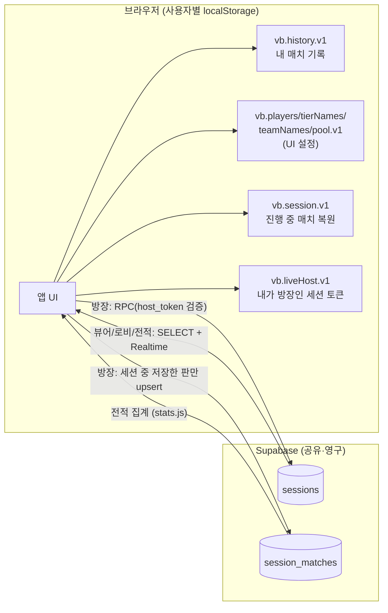

# 데이터 구조 (DATA.md)

> **이 문서 하나로 "지금 무엇이 어디에 어떤 모양으로 기록되는지" 전부 파악**하는 것이 목표.
> SSOT: 서버 스키마 = `backend/supabase/schema.sql` · 브라우저 키 = `frontend/shared/storage.js` · 레코드 생성 = `frontend/features/summary/summary.js`
> 갱신: `/review-data` (end-day 시 자동). 마지막 갱신: 2026-11-14

## 한눈에 보는 흐름



## Supabase

### 테이블

**`sessions`** — 행 1개 = 방송(내전 세션) 1개
| 컬럼 | 타입 | 의미 |
|---|---|---|
| id | text PK | URL(`#/s/<id>`)에 쓰는 8자 난수 |
| created_at / updated_at | timestamptz | updated_at 은 방장 push·30초 하트비트로 갱신 → 로비 "활동 중" 판별(30분) |
| ended_at | timestamptz null | **null=진행 중, 값 있으면 아카이브(종료)**. 경기 0판 종료 시엔 행 자체가 삭제됨 |
| host_token | text | 방장 증명 (방장 브라우저 vb.liveHost.v1 에만 존재) |
| state | jsonb | 중계 상태 스냅샷: `{title(방 이름), players, tierNames, teamNames, pool, teams, map, mapLocked, sides, step, savedCurrent, score, ended?}` |

**`session_matches`** — 세션에 저장된 경기 (세션 삭제 시 cascade)
| 컬럼 | 타입 | 의미 |
|---|---|---|
| id | text PK | 매치 레코드 id (`m_...`) |
| session_id | text FK→sessions | 인덱스 있음 (`idx_session_matches_session`) |
| created_at | timestamptz | |
| record | jsonb | 아래 "매치 레코드 스키마" 그대로 |

### RPC (쓰기는 전부 이 함수들로만 — RLS 가 직접 쓰기를 전면 거부)

| 함수 | 호출자 | 하는 일 |
|---|---|---|
| create_session(id, token, state) | 누구나 | 방 생성 (토큰은 생성자가 만들어 보관) |
| update_session_state(id, token, state) | 방장 | 상태 push + updated_at 갱신 (하트비트 겸용) |
| add_session_match(sid, token, mid, record) | 방장 | 경기 upsert |
| delete_session_match(sid, token, mid) | 방장 | 경기 삭제 |
| end_session(id, token) | 방장 | **아카이브**: ended_at=now + state.ended=true (기록 보존) |
| delete_session(id, token) | 방장 | 완전 삭제 (경기 0판 종료 시 자동 사용·테스트 정리) |

### 정책·실시간

- RLS: `sessions`/`session_matches` **SELECT 는 공개**(링크·로비·전적이 전제), INSERT/UPDATE/DELETE 정책 없음 = 거부
- Realtime 발행: 두 테이블 모두 → 뷰어가 `postgres_changes` 구독 (sessions UPDATE, session_matches INSERT/UPDATE)
- 접속 정보: `frontend/app/env.js`(gitignore) / 배포는 Actions Secrets → publishable 키는 RLS 전제로 공개 가능 등급

## localStorage (origin = 포트/도메인별로 분리!)

| 키 | 내용 | 소유 모듈 |
|---|---|---|
| vb.history.v1 | 내 매치 기록 배열 (최대 200, createdAt 내림차순) | data/adapters/local.js |
| vb.players.v1 / vb.tierNames.v1 / vb.teamNames.v1 / vb.pool.v1 | 입력·설정 | features 각자 (storage 경유) |
| vb.session.v1 | 진행 중 매치 (새로고침 복원) | shared/session.js |
| vb.liveHost.v1 | `{세션id: {token, at(시작시각), title(방이름)}}` — 구버전 문자열 토큰도 호환 | features/live-session |

## 매치 레코드 스키마 (jsonb `record` = localStorage 항목 동일)

```json
{ "id": "m_xxx", "createdAt": "ISO", "manual": true?, "map": "split", "mapName": "SPLIT",
  "teams": { "A": {"name","side":"ATK|DEF","players":[{"tier","tierName","name"}]}, "B": {...} },
  "score": {"A":13,"B":6} | null, "winner": "A"|"B"|"draw"|null, "schemaVersion": 2 }
```

| 버전 | 추가된 것 |
|---|---|
| 1 | 최초 (id·createdAt·map·teams·sides) |
| 2 | score, winner, manual |
| 3 (예정) | players[].agent, players[].kills/deaths/assists — 스크린샷 스탯용. **필드는 추가만**(하위 호환) |

## 용량 현황 (무료 티어 500MB)

경기 1판 ≈ 1~2KB → 연 100판 기준 수백 KB. 세션 state ≈ 2~4KB/행. **수년간 걱정 없음.** keep-alive 워크플로우가 3일마다 핑 (무활동 일시정지 방지).
